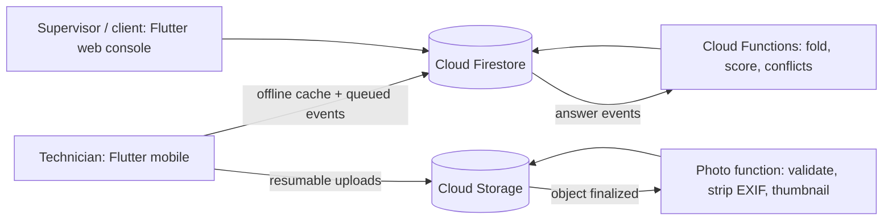

# FieldProof

**Offline-first inspections for field maintenance teams.** FieldProof lets technicians complete checklists, capture photos and sign off with no connectivity, then syncs safely when the signal returns. Supervisors resolve conflicts and approve reports before a client sees them.

> **Status:** early development, following an 8-week roadmap (see below). No application code yet. All companies, sites, assets and photos are synthetic or staged; this is not a certified compliance record.

## The problem

Technicians inspect fire extinguishers, HVAC units, elevators and forklifts in basements and remote sites with poor signal. Paper forms and spreadsheets lose photos, get retyped, and reports reach the client days later.

## Who it's for

- **Technicians:** complete inspections in the mobile app, online or offline
- **Supervisors:** assign work, resolve conflicts and approve reports in the web console
- **Client viewers:** read approved reports for their own sites
- **Admins:** manage checklist templates, rules and users

## Demo workflow

1. A supervisor assigns "Quarterly extinguisher check — Building C" to two technicians
2. Both phones go into airplane mode; each answers part of the checklist, and both answer item 7 differently
3. Photos are captured offline
4. Back online, events sync and the conflict on item 7 is recorded instead of overwritten
5. The supervisor compares both answers with their photos and resolves it
6. Rules mark two failures and set a re-inspection date in 30 days
7. The supervisor reviews the drafted report, approves it, and the client viewer opens the PDF

## Planned features

- Sign-in, organizations and roles enforced by security rules
- Sites, assets and offline QR lookup
- Versioned checklist templates with rule-based scoring
- Assignments with due dates
- Offline inspection runner with photos, notes and signature
- Sync engine built on append-only answer events with client-generated IDs
- Explicit conflict records, never silent overwrites
- Resumable photo uploads with EXIF and GPS metadata removed on the server
- Golden scoring fixtures run against both the Dart and TypeScript engines
- Drafted report narratives and photo tag suggestions that require supervisor approval
- Push notifications without sensitive content
- Client viewer for approved reports

## Tech stack

| Layer | Technology |
|---|---|
| Mobile app and web console | Flutter, Dart, Riverpod, go_router |
| Backend | Firebase Authentication, Cloud Firestore, Cloud Storage |
| Server logic | Cloud Functions for Firebase (TypeScript) |
| Notifications | Firebase Cloud Messaging |
| Local environment | Firebase Local Emulator Suite |
| CI | GitHub Actions |

## Architecture

The mobile app writes answer events to Firestore's offline cache and queues photo uploads. Cloud Functions fold events into each inspection, detect conflicts, compute scores and process photos. Supervisors and clients use a Flutter web console. Shared scoring rules live in a pure Dart package, mirrored by an authoritative TypeScript engine, and both run the same golden fixtures.



### Planned repository layout

```text
fieldproof/
├── apps/mobile/               # Flutter app: runner, sync, camera
├── apps/console/              # Flutter web: supervisor, admin, client viewer
├── packages/fieldproof_core/  # pure Dart models, preview scoring, event folding
├── packages/fieldproof_ui/    # shared widgets and theme
├── functions/                 # Cloud Functions (TypeScript)
├── firebase/                  # security rules, indexes, emulator config
├── fixtures/                  # golden scoring fixtures and synthetic seed data
├── tests/                     # rules, functions and end-to-end tests
└── docs/                      # architecture decisions, sync protocol, runbooks
```

## Design rules

- No answer is ever lost across offline/online cycles.
- Concurrent conflicting edits always produce a conflict record.
- Scoring matches golden fixtures in both engines.
- Security rules deny by default, and every collection has tests.
- Every approved report has a human approver; clients never see drafts or internal notes.

## Roadmap

| Week | Focus | Status |
|---|---|---|
| Week 1 | **Product definition & Flutter/Firebase bootstrap** — Add charter, ADR 0001 and Dart workspace, configure Firebase emulators, functions and deny-by-default rules | Planned |
| Week 2 | **Authentication, orgs & roles** — Add sign-in with Riverpod session state and role claims, add org and role security rules with role-aware navigation | Planned |
| Week 3 | **Templates, scoring & online runner** — Add versioned checklist templates with Dart and TypeScript scoring, add template editor and publishing, add assignments, QR lookup and checklist runner, add idempotent event folding | Planned |
| Week 4 | **Offline-first sync** — Add offline sync protocol with idempotent event writes, add local pending queue and sync status screen | Planned |
| Week 5 | **Conflict detection & resolution** — Detect and record answer conflicts, add conflict resolution callable and resolver | Planned |
| Week 6 | **Photos, submission & staging** — Add photo capture, resumable uploads and EXIF stripping, add idempotent submission, notifications and review queue, set up staging project and budgets | Planned |
| Week 7 | **Report drafts, approved reports & client viewer** — Add validated report drafts with console review, add photo tag suggestions and approved PDF reports, add client viewer area | Planned |
| Week 8 | **Hardening & release** — Audit rules and callables, enforce App Check, run direct-write abuse suite and restore rehearsal, tag release candidate with demo seed and changelog, publish test build and web console | Planned |

## Getting started

Setup instructions will be added once the first apps are in place.
